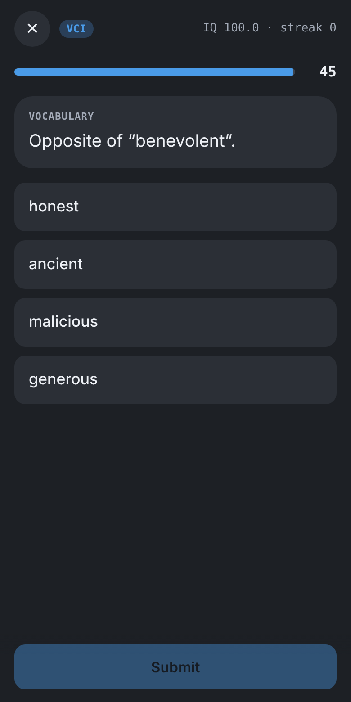
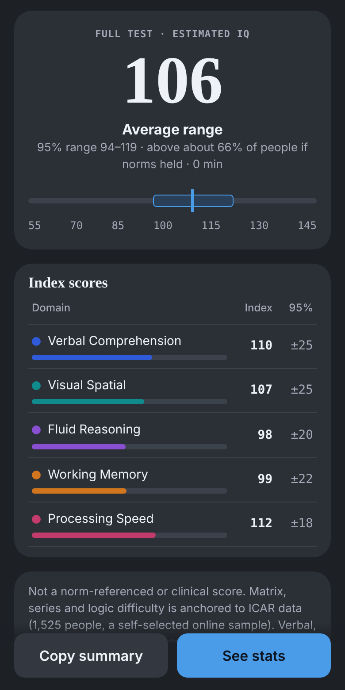
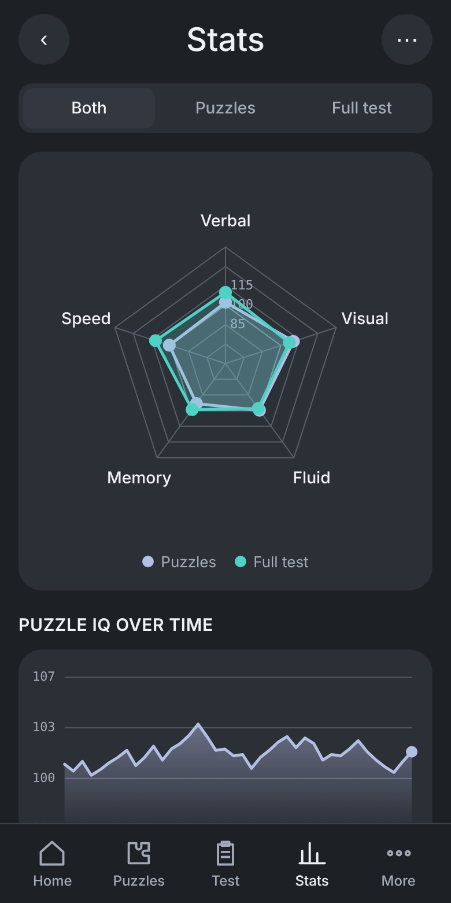

# IQ Lab

A phone-first IQ practice and estimation app. It asks one question at a time, scores you with item-response theory, and keeps a detailed answer log so you can analyse weak spots later. Plain HTML/CSS/JS, no framework, no server. It also ships as a small Android APK.

> **Not a clinical test.** Scores are uncalibrated estimates, not norm-referenced. See [Accuracy and limits](#accuracy-and-limits).

| Puzzle | Full-test result | Stats |
|---|---|---|
|  |  |  |

Screenshots use simulated demo answers.

## Features

| Area | What it does |
|---|---|
| **Puzzles mode** | Adaptive, one or many, quit any time. Puzzle IQ starts at 100 and moves up or down after every answer (Elo-style) |
| **Full test** | 50 tasks, 10 per domain, easy to hard, about 35–45 minutes, feedback only at the end |
| **Five domains** | Verbal Comprehension, Visual Spatial, Fluid Reasoning, Working Memory, Processing Speed (WAIS-style structure) |
| **Timers** | Per-question countdown in both modes. Time's up counts as a miss. Relaxed, Standard or Strict allowance |
| **No memorising** | Most items are generated (matrices, mental rotation, number and letter series, ordering, digit span, symbol tasks). Static verbal and logic items are tracked as seen across both modes |
| **Stats** | Radar chart (puzzles vs full test), puzzle IQ line, full-test bars with 95% range, per-domain table |
| **Weak spots** | Per question type: answers, accuracy, average difficulty level, seconds, timeout rate. Plus a time-of-day split |
| **Export / import** | JSON backup, CSV with one row per answer, JSON import |

## Install

**Android (APK):** download [`releases/IQ-Lab-v1.1.apk`](releases/IQ-Lab-v1.1.apk), open it, allow installs from that source once. Works offline. Scores stay on the device. Uninstalling or clearing app data deletes them, so export now and then.

**Browser (any phone or computer, including iPhone):** open https://matheusgr76.github.io/IQ_lab/ and use "Add to Home screen" in the browser menu. Scores are saved in that browser's local storage. To run it locally, open `web/index.html`.

_Hosting note:_ the page is served by GitHub Pages from the repo root (`index.html` redirects to `web/`). Enable it under Settings → Pages → Branch `main`, folder `/ (root)`.

## Build the APK

No Android SDK needed. It uses [apktool](https://www.npmjs.com/package/apktool-jar) and a pure-JS signer from npm.

```bash
cd android
./build.sh        # needs java, node/npm, openssl
```

Output: `releases/IQ-Lab-local.apk`. The script creates a signing key in `android/keys/` on first run. **Keep that key**: an update only installs over an existing app if it is signed with the same key. The key is git-ignored.

The app is a thin WebView shell (`android/smali/`) that loads `web/` from its assets. Min Android 7.0 (API 24).

## How scoring works

- **Items:** each item has a difficulty `b` and a guessing floor `c` (1 / number of options). Probability correct is `c + (1 − c) / (1 + exp(−1.2·(θ − b)))`.
- **Full test:** ability θ per domain by expected-a-posteriori estimate over a grid with a standard-normal prior. Domain index = `100 + 15·θ`. Processing Speed uses direct speed measures as a Gaussian likelihood.
- **FSIQ:** weighted composite of the domain indexes (VCI .25, VSI .20, FRI .25, WMI .15, PSI .15) with a stretch factor of 1.25, because a composite of imperfectly correlated scores has less spread than a single score.
- **95% range:** ±1.96 × posterior SD, plus extra calibration uncertainty added in quadrature (judgement values, listed in `web/engine.js`). Minimum half-width 4 points.
- **Puzzles mode:** per-domain θ updated after each answer with a step that shrinks as answers accumulate (K = .45, .30, then .20). The next puzzle favours domains with fewer answers and difficulty near your current θ. Puzzle IQ is the weighted mean of domain θ; untested domains count as 100.

## Accuracy and limits

- No population norms. "Percentile" means "if norms held".
- Difficulty of matrix, series and logic items is shifted using sample data from the [ICAR](https://icar-project.com) item bank (psychTools `ability` dataset, N = 1,525, a self-selected online sample). Only the shift constants (`CAL` in `web/gen.js`) came from that data. No ICAR items or data are included in this repo.
- Verbal, mental-rotation (2D here, 3D in ICAR), working-memory and speed items are not anchored to any external data.
- Processing Speed is the least reliable index. Puzzle IQ saturates around 125–130 until harder levels are added.
- Typical 95% range for an average scorer is about ±12 points. A 5-point change between two tests is noise.

## Data model

Everything lives in one JSON object (`localStorage` key `iq-state`):

| Key | Content |
|---|---|
| `P` | Puzzle state: per-domain θ and counts, history `[unix_time, puzzle_iq]`, totals, streaks |
| `F` | Full-test results: date, FSIQ, 95% range, minutes, five domain scores |
| `L` | Answer log (last 4,000 answers), see below |
| `seen` | Static item IDs already shown (last 400) |
| `set` | Settings |

Answer log row: `[unix_time, mode (p/f), domain, type, level 1–5, correct 0/1, seconds, timed_out 0/1, puzzle_iq_after, speed_z, session_start]`.

CSV columns: `datetime, mode, session, domain, type, level, correct, seconds, timed_out, puzzle_iq_after, speed_z`.

### Cloud mode (optional)

If the page runs inside a host that provides a `claude.use('db')` and `claude.use('user')` runtime, `web/store.js` also syncs the state there. Outside such a host it silently uses local storage only.

## Repository layout

```
web/        the app (index.html, scripts, styles)
android/    WebView shell, resources, build script
logo/       icon sources (SVG)
releases/   built APK
docs/       screenshots
```

## License

MIT, see [LICENSE](LICENSE).

## Disclaimer

For personal practice and curiosity only. It is not a diagnostic instrument and its scores must not be used for clinical, educational or employment decisions.
